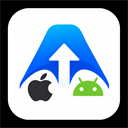

<p align="center">
  
</p>

<h1 align="center">Launchsheet</h1>

<p align="center">
  <b>Set up your App Store listings from a spreadsheet.</b><br>
  A Chrome extension that reads a CSV and creates or updates apps in App Store Connect for you: names, descriptions, keywords, categories, App Review details, and more. Google Play support is planned.
</p>

<p align="center">
  
  
  
</p>

> **Unofficial.** Launchsheet is not affiliated with or endorsed by Apple. It talks to the same private web API that the App Store Connect website uses, through your own logged-in session. That API is undocumented and can change without notice. Use it with your own account, try a dry run first, and review changes in App Store Connect. See [Limitations](#limitations).

## Features

- **Create or update:** for each `bundle_id`, an existing app is updated and a missing one is created.
- **Spreadsheet driven:** one CSV row per app per locale. Excel users: Save As > CSV UTF-8.
- **Dry run first:** on by default. Reads from App Store Connect and lists what would change, without saving anything.
- **Minimal writes:** only fields that differ from what App Store Connect already has are sent. Empty cells never overwrite existing data.
- **Validation before running:** required columns, Apple's character limits, duplicate locales, email and phone checks.
- **Clear failures:** each step reports its own error, and one rejected field doesn't stop the rest of the app.
- **Runs locally:** no server, no account, no telemetry. See [Privacy](#privacy-and-security).

### What it can set

| Area | Fields |
|---|---|
| App creation | bundle ID, SKU, name, primary locale, first version |
| Store listing (per locale) | name, subtitle, description, keywords, promotional text, what's new, support URL, marketing URL, privacy policy URL |
| App information | copyright, primary and secondary category, new version string |
| App Review information | contact first/last name, email, phone, demo account username and password, review notes |

Not covered yet: screenshots and previews, age rating, pricing and availability, builds, in-app purchases, and Google Play.

## Install

**From a release (recommended)**

1. Download `launchsheet-vX.Y.Z.zip` from the [Releases page](https://github.com/shahsawoodshinwari/launchsheet/releases) and unzip it.
2. Open `chrome://extensions` and turn on **Developer mode**.
3. Click **Load unpacked** and choose the unzipped folder (the one containing `manifest.json`).

**From source**

```bash
git clone https://github.com/shahsawoodshinwari/launchsheet.git
```

Then load the cloned folder with **Load unpacked** as above. Requires Chrome 114 or newer (side panel support).

## Usage

1. Sign in at [appstoreconnect.apple.com](https://appstoreconnect.apple.com) in a Chrome tab and keep it open.
2. On that tab, click the Launchsheet toolbar icon to open the side panel. The icon and panel are only enabled on App Store Connect tabs, and the panel only acts on the tab it was opened from.
3. **Choose file** and pick your CSV. The panel validates it and shows a preview. Fix any errors it lists.
4. Leave **Dry run** on and press **Run dry run**. Read the activity log.
5. Turn **Dry run** off and press **Run and apply changes** (you'll be asked to confirm).

Start from [`sample/apps.csv`](sample/apps.csv).

### Prerequisites

- The bundle ID must already be registered under Certificates, Identifiers & Profiles at [developer.apple.com](https://developer.apple.com/account).
- The app name must be unique across the App Store, and your account needs a role that can create and edit apps.

## CSV reference

One row per app per locale. Columns can be in any order, and unknown columns are ignored. App-level values are read from the first non-empty cell across that app's rows, so fill them in once.

| Column | Level | Notes |
|---|---|---|
| `platform` | row | `ios` (default). `android` rows are skipped for now. |
| `bundle_id` | app | **Required.** Matched exactly. |
| `sku` | app | Required only when creating an app. |
| `primary_locale` | app | Default `en-US`. |
| `version` | app | Used when creating, and to create a new version when none is editable. |
| `copyright` | app | |
| `primary_category`, `secondary_category` | app | Category ID, such as `PRODUCTIVITY`, `UTILITIES`, `HEALTH_AND_FITNESS`. Names like `Health & Fitness` are converted. Must differ. |
| `locale` | row | For example `en-US`, `de-DE`. Defaults to `primary_locale`. |
| `name`, `subtitle` | row | Max 30 characters. `name` is required when creating. |
| `description` | row | Max 4000. |
| `keywords` | row | Max 100, comma separated. |
| `promotional_text` | row | Max 170. |
| `whats_new` | row | Max 4000. Skipped automatically on an app's first version. |
| `support_url`, `marketing_url`, `privacy_policy_url` | row | |
| `contact_first_name`, `contact_last_name`, `contact_email`, `contact_phone_number` | app | App Review contact. Phone number should include the country code, such as `+1 555 123 4567`. |
| `username`, `password` | app | Demo account for reviewers. Setting either one marks sign-in as required. |
| `notes` | app | Review notes, max 4000. |

## How it works

Apple's official App Store Connect API cannot create apps, and it needs API keys. Launchsheet instead runs a small script inside the App Store Connect tab and calls the same `/iris/v1` endpoints the website uses, so requests are same-origin and reuse your existing session cookies.

```
CSV  ->  side panel (parse + validate)  ->  content script in the App Store Connect tab
                                              1. find app by exact bundle ID, else create it
                                              2. find the editable version
                                              3. update version, review info and locale text (changed fields only)
                                              4. update app info and categories
```

## Privacy and security

- Launchsheet only requests access to `https://appstoreconnect.apple.com/*`. It does not contact any other server and has no analytics. The toolbar icon and side panel stay disabled on every other site, and a run only touches the single tab it was opened from.
- Your CSV is read in the browser and never uploaded anywhere except to App Store Connect as part of the requested changes.
- Passwords from the CSV are sent to App Store Connect but are never written to the activity log.
- **Keep CSVs that contain demo passwords out of git and shared folders.** This repository's `.gitignore` excludes `*.csv` except the sample.

Found a vulnerability? Please open a private security advisory under the repository's Security tab instead of a public issue.

## Limitations

- Built on undocumented endpoints. If Apple changes them, a step may fail until the extension is updated.
- Tested on a single account so far. Some steps, such as categories and review details, are newer and less proven than the listing text steps. Always run a dry run first.
- Automating a web service you're signed in to may be restricted by that service's terms. You are responsible for using this tool in line with the terms that apply to your account.
- Screenshots, pricing, age ratings and builds must still be done in App Store Connect.

## Roadmap

- [ ] Google Play Console support
- [ ] `.xlsx` upload (CSV only today)
- [ ] Screenshots and app previews
- [ ] Age rating, pricing and availability
- [ ] Optional step that opens each app's page when it is finished

## Development

```bash
npm test         # CSV parser and validation tests (Node 22+)
npm run check    # syntax check of every script
```

Project layout:

```
manifest.json          Extension manifest (Manifest V3)
background.js          Opens the side panel from the toolbar icon
panel/                 Side panel UI (HTML, CSS, JS) and CSV parsing (csv.js)
content/asc.js         Runs inside the App Store Connect tab and calls the API
sample/apps.csv        Example input
tests/                 Node test runner tests
```

Load the repository folder as an unpacked extension and use the reload button on `chrome://extensions` after each change.

### Releasing

1. Update the version in both `manifest.json` and `package.json` (a test enforces they match).
2. Add an entry to `CHANGELOG.md`.
3. Commit, then tag and push:

   ```bash
   git tag -a vX.Y.Z -m "vX.Y.Z"
   git push origin main vX.Y.Z
   ```

The Release workflow runs the tests, checks the tag against the manifest version, builds `launchsheet-vX.Y.Z.zip` and publishes a GitHub release.

## Contributing

Issues and pull requests are welcome. Please include a redacted activity log and the relevant CSV row when reporting a failure. Never paste passwords or tokens.

## License

[MIT](LICENSE)

Apple, App Store and App Store Connect are trademarks of Apple Inc. Google Play is a trademark of Google LLC. This project is not affiliated with either company.
